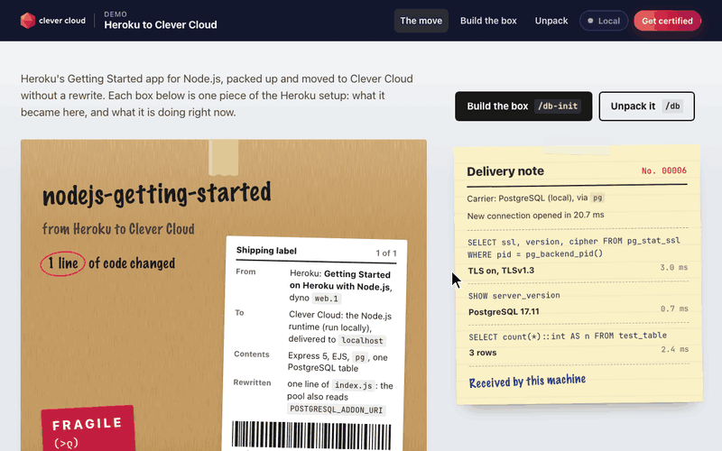
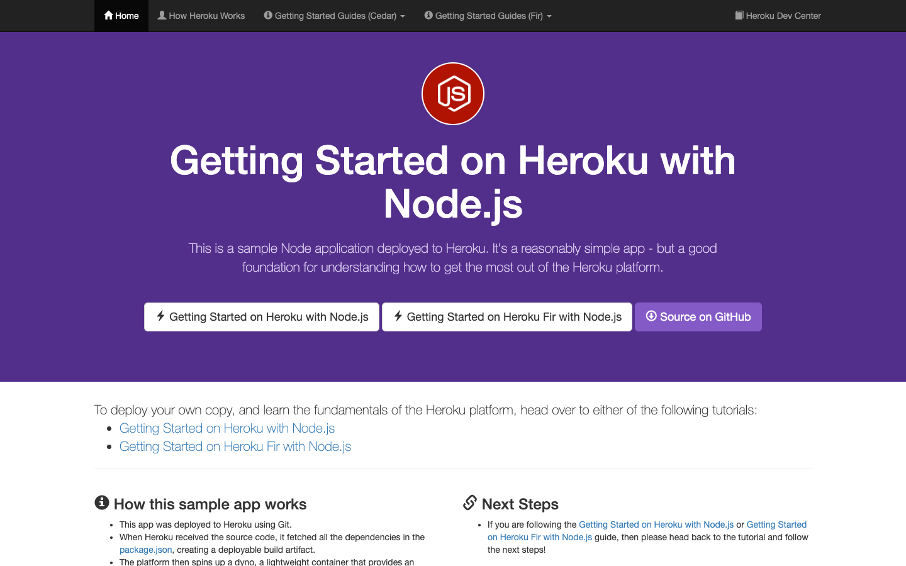
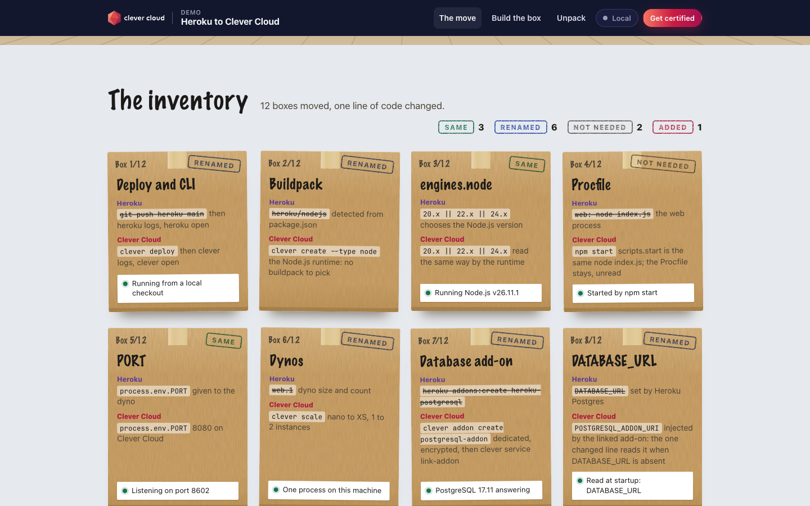
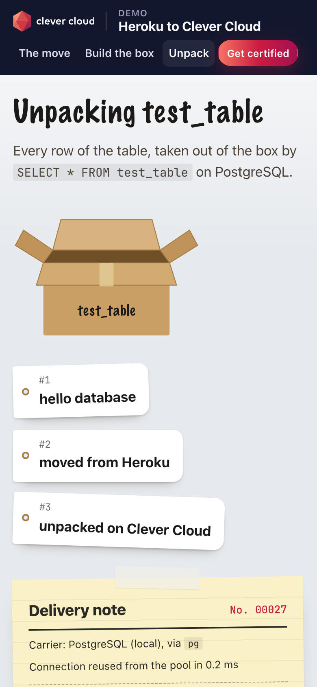

# Moving Day — Heroku's Node.js app and PostgreSQL on Clever Cloud

> Moving day for Heroku's *nodejs-getting-started* (Express 5, EJS): the app arrives at its new address as a kraft box with a shipping label, and its Heroku setup is unpacked as an **inventory of twelve boxes**. Each box says what a piece of the setup was on Heroku, what it became on Clever Cloud, carries an honest stamp (**same**, **renamed**, **not needed**, **added**) and a sticker with what that piece is doing right now in the running process. The move changed **one line of code**: the pool reads Heroku's `DATABASE_URL` or, when it is absent, `POSTGRESQL_ADDON_URI`, which the **PostgreSQL add-on** injects into the linked app. Every page pins a **delivery note** on the wall with the SQL it just ran on the add-on and how long each query took; `/db-init` builds the box (`test_table`) and `/db` unpacks its rows like tagged objects.









**Run it yourself.** The hosted demo was taken down after the presales review (November 2026). The steps in [Deploy on Clever Cloud](#deploy-on-clever-cloud) recreate it from scratch in about 5 minutes.

**Get certified.** This demo runs on Clever Cloud. To deploy your own apps the same way, get certified at the [Clever Cloud Academy](https://academy.clever.cloud/).

## What Clever Cloud does in the demo

| Where | What runs | What you see |
|---|---|---|
| Every page | The pool connects to the PostgreSQL add-on over TLS (`ssl: { rejectUnauthorized: false }`, as on Heroku) | The **delivery note**: new or reused connection and its time, then each SQL statement with its outcome and duration |
| `/` | `SELECT ssl, version, cipher FROM pg_stat_ssl WHERE pid = pg_backend_pid()`, `SHOW server_version`, `SELECT count(*) FROM test_table` | The TLS version and cipher, the PostgreSQL version and the row count, on the stickers of the boxes *TLS to the database*, *Database add-on* and *The table* |
| `/` | The Node.js runtime: `npm start`, `PORT`, `engines.node`, `INSTANCE_NUMBER` | The stickers *Started by npm start*, *Listening on port 8080*, *Running Node.js v…*, *Instance N, type* (or *One process on this machine* locally) |
| `/db-init` | `SELECT to_regclass('test_table') IS NOT NULL`, then `CREATE TABLE IF NOT EXISTS test_table (id SERIAL PRIMARY KEY, name VARCHAR(100))` | The box gets taped and stamped *Database initialized*; curl still gets that plain text |
| `/db` | `SELECT * FROM test_table` | Each row as a tag taken out of the open box |
| Every page | Only `CC_APP_NAME`, `APP_ID`, `INSTANCE_NUMBER`, `INSTANCE_TYPE`, `CC_PRETTY_INSTANCE_NAME`, `CC_COMMIT_ID` (short), `CC_DEPLOYMENT_ID` | The **Running on Clever Cloud** panel (« Local » off the platform), next to the **Certified movers** box: the Clever Cloud Academy certification |

## The inventory: what changes from Heroku to Clever Cloud

| Box | On Heroku | On Clever Cloud | Stamp | In this repo |
|---|---|---|---|---|
| Deploy and CLI | `git push heroku main`, `heroku logs --tail`, `heroku open` | `clever deploy` (pushes to the app's Clever Cloud git remote), `clever logs`, `clever open` | Renamed | — |
| Buildpack | `heroku/nodejs` | `clever create --type node`: the Node.js runtime | Renamed | — |
| `engines.node` | 20.x, 22.x or 24.x | Read the same way by the Node.js runtime | Same | Unchanged |
| `Procfile` | `web: node index.js` | Not read: the runtime runs `npm start`, and `scripts.start` is `node index.js` | Not needed | `Procfile` kept |
| `PORT` | Given to the dyno | Given by Clever Cloud (8080) | Same | `process.env.PORT \|\| 5006`, unchanged |
| Dynos | `web.1`, dyno size and count | `clever scale`: nano to XS, 1 to 2 instances | Renamed | — |
| Database add-on | `heroku addons:create heroku-postgresql` | `clever addon create postgresql-addon` then `clever service link-addon` | Renamed | — |
| `DATABASE_URL` | Set by Heroku Postgres | `POSTGRESQL_ADDON_URI` (and `_HOST`, `_PORT`, `_DB`, `_USER`, `_PASSWORD`), injected by the linked add-on | Renamed | **The one changed line** (commit `5f1cfec`): `process.env.DATABASE_URL \|\| process.env.POSTGRESQL_ADDON_URI` |
| TLS to the database | `ssl: { rejectUnauthorized: false }` | The same: the add-on accepts TLS | Same | Unchanged |
| Config vars | `heroku config:set`, `.env` read by `heroku local` | `clever env set`, `.env` read by `npm run local` | Renamed | `.env.example` (`TIMES=2`), copied to `.env` |
| The table | `heroku pg:psql`, then `create table` | `/db-init` creates `test_table`; rows go in with `psql "$POSTGRESQL_ADDON_URI"` | Added | `/db-init` added for the move (commit `f7ab34a`) |
| `app.json` | The Heroku Button manifest | Not read | Not needed | Kept |

The move itself is the one line above. The moving-day interface came afterwards, for the demo, with three fixes that do not depend on the platform: `/db` answers **503** with a clear message before `/db-init` (it used to print the error text with a 200), the PostgreSQL pool is closed on `SIGTERM` so the process stops, and `npm run local` reads `.env`.

## Deploy on Clever Cloud

You need [clever-tools](https://www.clever.cloud/developers/doc/cli/) (`clever login` done), `psql`, and the ID of the organisation that will own the resources (`orga_…`, shown in the Console). Run the commands from the repo root: `clever create` links the folder to the new app.

```bash
# 1. The app and its size (heroku create)
clever create --type node demo-heroku-nodejs-pg --org <org_id> --region par
clever scale --min-flavor nano --max-flavor XS --min-instances 1 --max-instances 2

# 2. PostgreSQL (dedicated xxs_sml, encrypted at rest), linked to the app (heroku addons:create heroku-postgresql)
clever addon create postgresql-addon demo-heroku-db --plan xxs_sml --option encryption=true --region par --org <org_id> --yes
clever service link-addon demo-heroku-db

# 3. Variables (heroku config:set): optional, /times counts to 5 without it
clever env set TIMES 2

# 4. Deploy (git push heroku main)
clever deploy
clever open

# 5. The table and a first row (heroku pg:psql); eval loads the app's variables into this shell without printing them
curl -s https://<app-domain>/db-init     # "Database initialized"; clever domain gives <app-domain>
eval "$(clever env -F shell)"
psql "$POSTGRESQL_ADDON_URI" -c "INSERT INTO test_table (name) VALUES ('hello database')"
```

Then open `/db`. Before step 5 it answers **503**, *This box isn't built yet*, with a link to `/db-init`; opened in a browser, `/db-init` shows the box being taped, while curl gets the same `Database initialized` as before.

## Variables

| Variable | Set by | Role |
|---|---|---|
| `POSTGRESQL_ADDON_URI` | PostgreSQL add-on (linked) | Connection string, read when `DATABASE_URL` is absent; the page shows its name, never its value |
| `DATABASE_URL` | Heroku Postgres; nobody on Clever Cloud | Read first: set it locally |
| `PORT` | Clever Cloud | Listening port: 8080; `5006` locally by default |
| `TIMES` | you, optional | `/times` counts from 1 to it; default 5; `npm run local` reads `TIMES=2` from `.env` (copy of `.env.example`) |
| `CC_APP_NAME`, `APP_ID`, `INSTANCE_NUMBER`, `INSTANCE_TYPE`, `CC_PRETTY_INSTANCE_NAME`, `CC_COMMIT_ID`, `CC_DEPLOYMENT_ID` | Clever Cloud | Shown in the *Running on Clever Cloud* panel and on the shipping label (barcode drawn from the deployment ID) |

## Routes

| Route | Answer |
|---|---|
| `/` | Moving day: the hero box, the delivery note (three queries), the inventory of twelve boxes. Renders without a database too |
| `/db-init` | Creates `test_table (id SERIAL PRIMARY KEY, name VARCHAR(100))` if missing. Browser: the *Box built* page; curl or any non-HTML `Accept`: `Database initialized` in plain text. 503 when PostgreSQL does not answer |
| `/db` | The rows of `test_table`, unpacked. 503 before `/db-init` (*This box isn't built yet*) or without PostgreSQL (*Nothing to unpack*) |
| `/cool` | A random ASCII face (`cool-ascii-faces`), also on the *Fragile* sticker of the hero box |
| `/times` | `1 2 3 4 5` (or up to `TIMES`) |
| static | `/cc-brand.css`, `/cc-badge.svg`, `/stylesheets/moving-day.css`; the original `/lang-logo.png`, `/node.svg`, `/stylesheets/main.css` are still served |

Like upstream, the app has no `/health` route.

## Code tour

```
index.js                    Express 5 app: routes, pg pool (DATABASE_URL || POSTGRESQL_ADDON_URI, TLS without CA check),
                            the delivery note (each query timed), 503s, SIGTERM closes the server and the pool
moving-day.js               the twelve boxes and their live stickers, the Clever Cloud panel (7 variables), the barcode
views/pages/index.ejs       the hero box, the shipping label, the inventory
views/pages/db-init.ejs     building the box
views/pages/db.ejs          unpacking the rows (and the 503 states)
views/partials/             head, Clever top bar, delivery note, certification and platform panel, footer, logo
public/cc-brand.css         Clever Brand Kit, copied as is
public/stylesheets/moving-day.css   the universe: wall, floor, kraft, tape, stamps; system fonts, no third-party resource
Procfile, app.json          Heroku only, kept
.env.example                TIMES=2; copied to .env, read by `npm run local` (heroku local on Heroku)
test.js                     jest: GET / on IPv4 and IPv6, the inventory, /cool and /times, 503s without PostgreSQL,
                            exit on SIGTERM; with TEST_DATABASE_URL, /db-init then /db
```

Forked from [heroku/nodejs-getting-started](https://github.com/heroku/nodejs-getting-started); the tutorial's `/cool`, `/times` and `/db` steps were added on top. The pages draw everything themselves (inline SVG and CSS, no bitmap image, no CDN, system fonts): the original Bootstrap 3 and jQuery from CDNs are gone.

## Run locally

```bash
npm install
cp .env.example .env    # TIMES=2; npm run local fails without .env
createdb readme_heroku    # any local PostgreSQL
DATABASE_URL="postgresql://localhost/readme_heroku?sslmode=disable" PORT=8303 npm run local
curl -s localhost:8303/db-init
npm test                  # add TEST_DATABASE_URL=<a disposable database> to run the database test too
```

`?sslmode=disable` is needed with a local PostgreSQL without TLS (`The server does not support SSL connections` otherwise): the parameters of the connection string override the `ssl` option of the code, and the *TLS to the database* box then says *TLS off*. `npm run local` is `node --env-file=.env index.js` (Node 20.6 or later), like `heroku local`; `npm start` ignores `.env`, and a variable already set in the shell wins over the file. Node 20, 22 or 24 (`engines`); on a newer version npm warns and the app still runs.

MIT License (`package.json`).
